<!-- Source: Wavy-Hec/MultiCam, code as run a477d80, review fixes 6c377c0, thinking-off control rerun at f4ba98d on 2026-10-31; written 2026-10-30, revised 2026-10-31 -->
# CVBench: can the questions be answered without the videos?

All four legs are complete: thinking and no thinking, each 1000 questions × 4 seeds × 2 option
orders (16,000 rows, 0 errors, 0 unparsed answers). As run, every batched call was seeded with 1,
which coupled the no-thinking control's answers across questions and option orders; on 2026-10-31
the control was rerun with per-call seeds (`_q38nt2`). The thinking-off numbers below come from the
rerun, except a few as-run figures quoted as history (sections 3.4, 5, 6 and 7). Every number below, apart
from the exceptions named next, was recomputed from raw result rows and carries its source.

**How the numbers were checked.** Apart from the rerun's numbers and the as-run figures quoted as
history, the numbers were checked twice, each time re-derived independently from the
raw rows, the archived rows of Era 1 (the earlier CVBench runs in MultiCam, June–July 2026;
section 4), git history and the job logs, and the
analysis and figure code was reviewed. The analysis JSONs and figures shipped here were regenerated
from the reviewed code (MultiCam `6c377c0`). Not recomputed: the figures of the rule-based audit in
section 4.4, which are quoted, and a few statements that the rows cannot check, such as the vLLM and
driver notes in section 5 and the statement in section 4.4 about the CVBench paper. Section 4
(Provenance) says what each check covered of the earlier runs. The rerun's numbers come from the
same code; they and those as-run figures were re-derived from the raw rows by two independent
checks on 2026-10-31.

**Code and files.** "MultiCam" below is the
[Wavy-Hec/MultiCam](https://github.com/Wavy-Hec/MultiCam) harness, where the experiment ran: commit
`a477d80` is the code as run, commit `6c377c0` holds the review fixes (section 5), and the
thinking-off control was rerun at commit `f4ba98d`, which carries them. In this
repository the result rows are in [`multicam_results/legs/`](../multicam_results/legs/) (section 6);
the analysis JSONs and the per-question list are in
[`multicam_results/cvbench_text_only/`](../multicam_results/cvbench_text_only/), whose
[README](../multicam_results/cvbench_text_only/README.md) describes them; the figures are in
[`figures/`](../figures/); and the O1 and O2 question subsets are in
[`data/subsets/`](../data/subsets/). Below, "the harness" means MultiCam's harness, where the
experiment ran and the changes of section 5 live; this repository's own harness (`inprocess/`) does
not run this protocol yet (section 8).

---

## 1. Summary

- **What was done.** CVBench (the cross-video QA benchmark: 1,000 questions, 15 task types,
  2–4 independent clips per question) is back in the MultiCam harness. We ran it **text-only** on
  **Qwen3.8-27B**: question and options, no frames. It follows the team's 27B text-only
  protocol (thinking at effort medium, 4 seeds, both option orders O1/O2, O2 = reversed) except
  for the prompt, an 8,192-token cap, batch-level seeding and the serving stack (section 5). A
  no-thinking control ran on the same questions.
- **Result.** With no video at all, Qwen3.8-27B answers about half of CVBench:
  - with thinking: **49.3% / 49.7%** (O1 / O2)
  - without thinking: **48.1% / 49.0%**
  - Chance is 28.5%. The best answer-key guesser reaches 37.4% in-sample and 30.9% leave-one-out
    (released order O1; O2: 37.5% and 31.0%). The model's own answer habits, shuffled across
    questions, reach 30.2–31.3% (both legs, both orders).
  - The thinking leg scores +1.0 points above the no-thinking control overall (95% interval −0.9
    to +2.9; the legs differ in thinking and in prompt), which is not separable from zero.
- **Text-answerable questions.** With thinking, **343 of 1000** questions are right in ≥ 3 of 4 seeds
  **in both option orders** (301 without thinking). Pure guessing would give about 16. If each
  question's answers, both orders together, are moved onto another question of the same task and
  answer space, **186.6** [166, 207] questions still pass on average. That baseline keeps the model's
  answer-format habits but also part of its accuracy (an always-right model would score 315.5 on
  it), so the excess of about 156 questions is a lower bound on what the question text adds, not an
  exact split.
  - **Lettered questions (864).** Here the rule is strict against letter habits, because reversing
    the options moves every letter (all but the malformed `cvb-996`). A habit that follows the
    option text still passes both orders, as a Yes/No habit can on `cvb-223`, a Yes/No question
    written as A/B options; no leg gets either question right. 296 pass, against 138.5 [120, 158]
    from the same shuffle.
  - **Yes/No questions (136).** The answer is a word, so a Yes/No habit passes both orders. The 47
    that pass are no more than the same shuffle gives (48.2 [40, 57]).
  - 225 questions pass in both modes and 419 in at least one. The per-question list is
    [`text_answerable_ids.json`](../multicam_results/cvbench_text_only/text_answerable_ids.json).
- **Where they sit.** Share of each task that passes, with thinking:
  - Highest, far above habits: Summarization 65%, Multi-view Scene Understanding 62%,
    Counterfactual Reasoning 58%, Procedural Transfer 53%.
  - Lowest: Object Recognition 21%, Anomaly Detection 15%, Event Retrieval 12%.
  - Not above the same shuffle, a conservative baseline (one-sided p ≥ 0.05, uncorrected): Event
    Retrieval (6 of 49), Counting (13 of 60) and Scene Recognition (54 of 149). With a Holm
    correction over the 15 tasks, Anomaly Detection (p = 0.027) joins them.
- **What it means for earlier results.** The questions that text alone answers are also where the
  with-video model scores highest. InternVL3-8B with video (61.8% overall) scores:
  - **78.7%** on the 343 that pass in both orders
  - 59.3% on the 207 that pass in one
  - **50.1%** on the 450 that pass in neither

  That fits a text prior inside its score, but easier questions would show the same pattern. A
  text-only run of InternVL3-8B itself would separate the two.
- **The Era-1 "+22 points from video" does not hold up.** The old 45-question comparison (40%
  without video, 62% with) depends on how cut-off outputs are parsed: 34 of the 45 no-video and 22
  of the 45 with-video outputs have no answer tag. The old first-letter fallback gives +22.2 points
  (McNemar p = 0.021), today's parser (the `<answer>` tag, else the last "the answer is X" phrase,
  hedged or not) gives +8.9 (p = 0.42), and the tag alone gives +31.1 (p = 0.0013). The slice
  cannot settle the video gain (section 4.3).

---

## 2. Figures

All figures are in [`figures/`](../figures/). They are generated by MultiCam's
`analysis/make_cvbench_text_figs.py` (at `6c377c0`), and every plotted number is in
[`fig_cvbench_data.json`](../multicam_results/cvbench_text_only/fig_cvbench_data.json), including
figure 11's bin counts. Where a figure shows one number per mode, it is the mean of the two option
orders. The exceptions are:

- Figure 5 is option order O1 only.
- The answer-key guesser in figures 1, 2 and 9 is the O1 value (O2: 37.5).
- Figure 11 pools the thinking leg's 8,000 answers, 4,000 per order.

**Figure 1** (`fig_cvbench_1_overall.png`): no-video accuracy (thinking, no thinking) vs chance,
answer-key baselines, both modes' bias nulls, and the best with-video result; the longest-option row
is on the 863 lettered questions, with their chance (25.1%) marked.

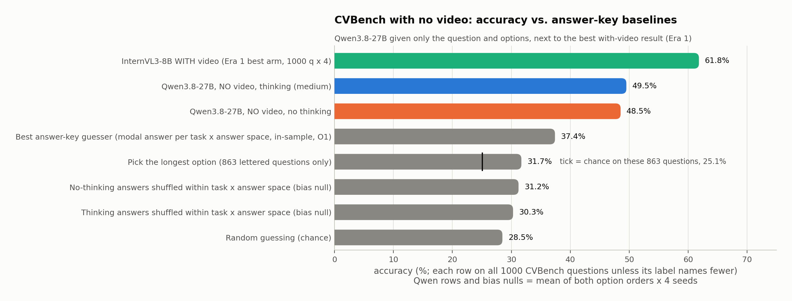

**Figure 2** (`fig_cvbench_2_per_task_accuracy.png`): per task: thinking, no thinking, InternVL3-8B
with video (Era-1 best arm: sequential, duration-weighted), chance, best key guesser.

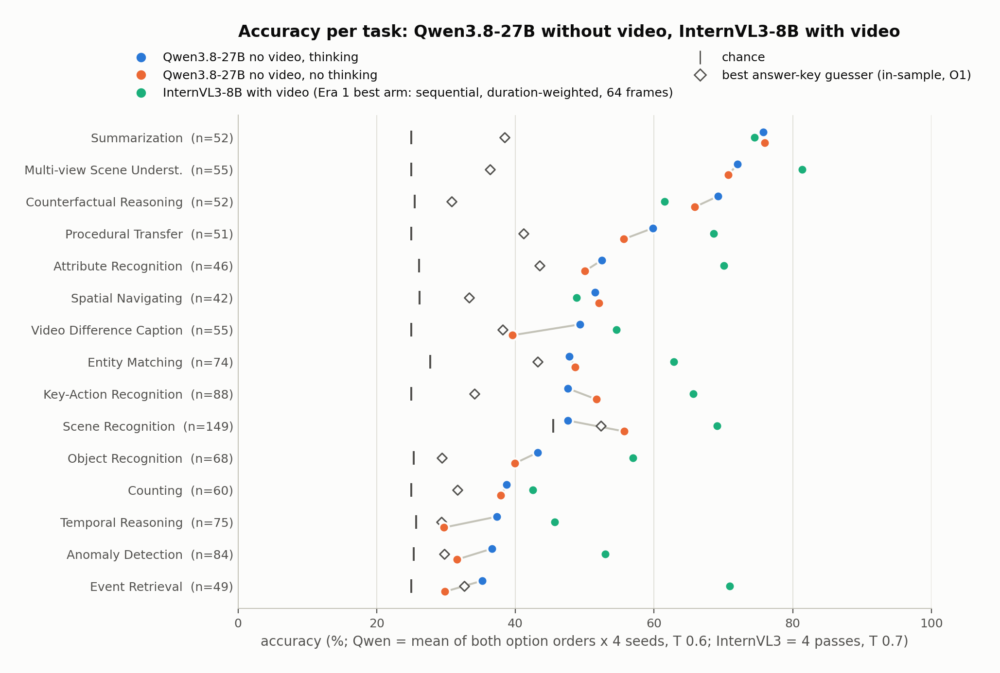

**Figure 3** (`fig_cvbench_3_text_answerable_by_task.png`): share of each task right in both orders
/ one order / neither (thinking); † marks tasks not above the paired null (one-sided p ≥ 0.05,
uncorrected).

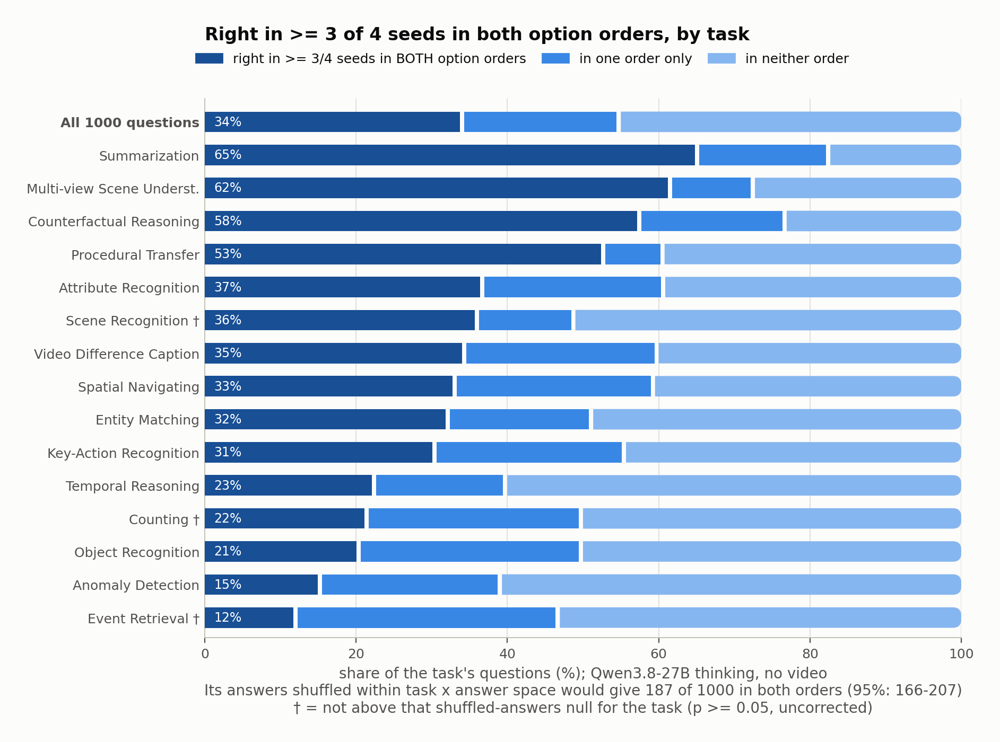

**Figure 4** (`fig_cvbench_4_observed_vs_null.png`): that share against pure guessing and the paired
null (the model's own answers moved to other questions, a conservative baseline), as a central 95%
range; the † in figure 3 is one-sided, so Anomaly Detection (13 of 84, on its range's upper end, p =
0.027) is still above the null.

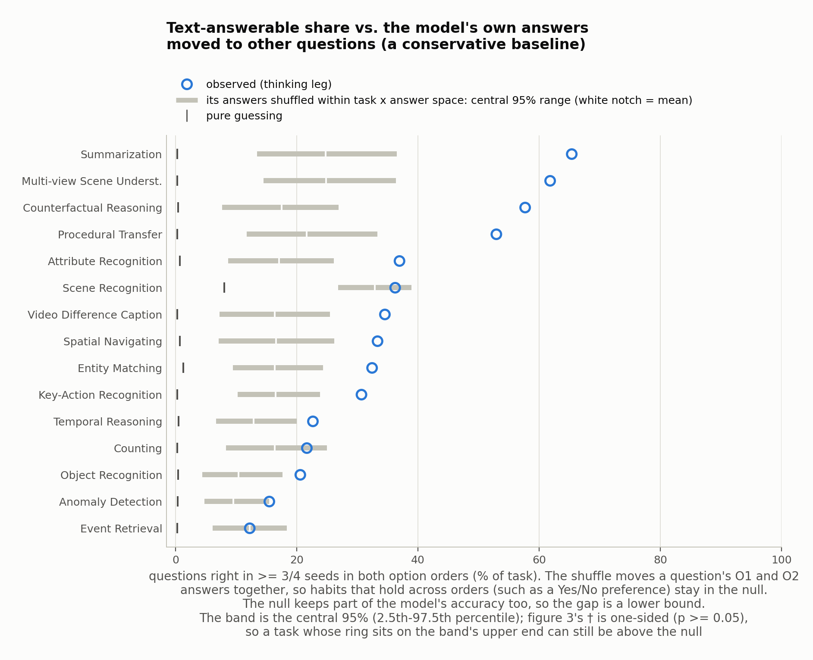

**Figure 5** (`fig_cvbench_5_passes_histogram.png`): 0–4 of 4 seeds right per question, O1 only (no
video, both modes, vs InternVL3-8B with video, Era-1 best arm).

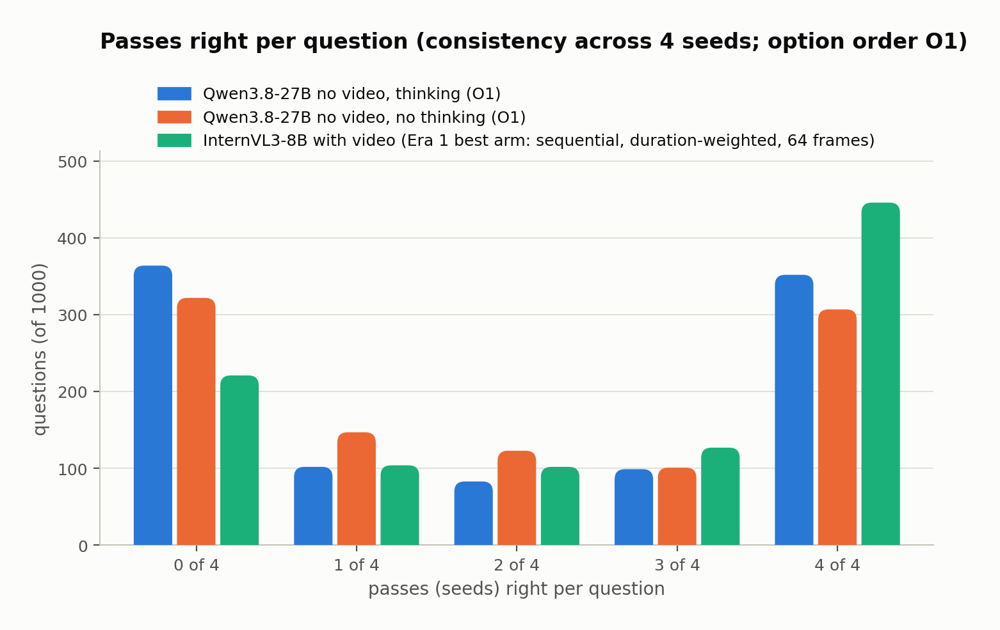

**Figure 6** (`fig_cvbench_6_sighted_by_text_label.png`): InternVL3-with-video accuracy split by the
both-orders label.

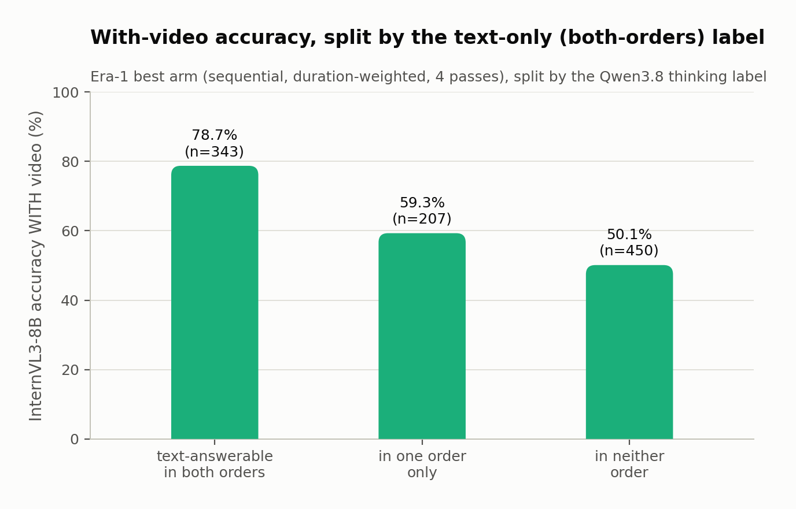

**Figure 7** (`fig_cvbench_7_thinking_minus_nothinking.png`): thinking leg minus no-thinking leg,
per task, with 95% intervals (the legs differ in thinking and in prompt).

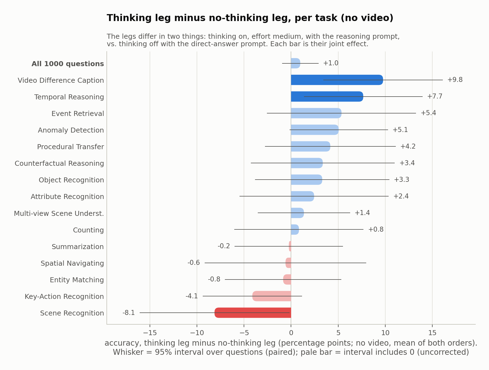

**Figure 8** (`fig_cvbench_8_answer_letters.png`): answer habits vs the answer key: letters per
option order (864 lettered questions), and Yes/No (136).

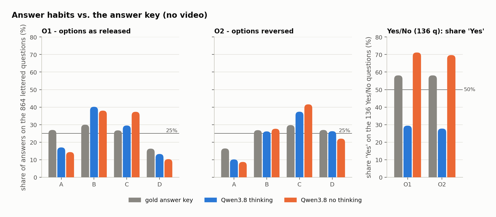

**Figure 9** (`fig_cvbench_9_history_full1000.png`): everything run on the full 1000 questions; the
no-thinking bar is the rerun `_q38nt2`, not the as-run control (section 5, Seeds).

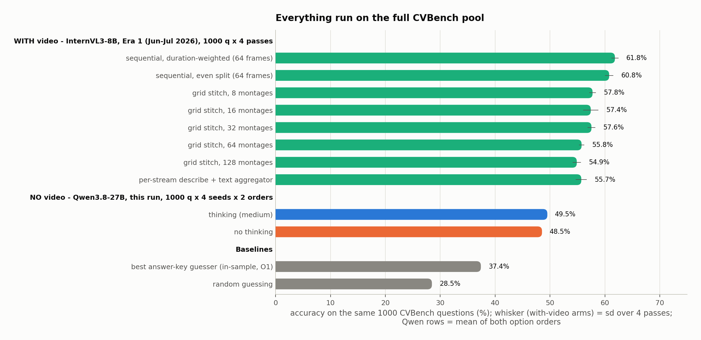

**Figure 10** (`fig_cvbench_10_stitch_sweep.png`): the Era-1 stitch montage sweep, with the
text-only levels; its note gives the 128-montage input length and says nothing was truncated.

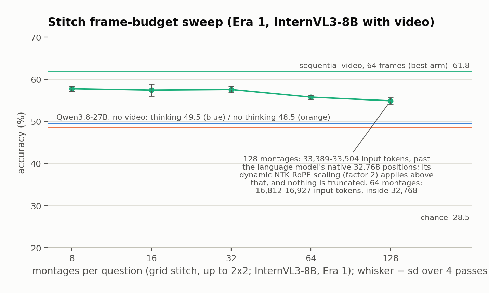

**Figure 11** (`fig_cvbench_11_reasoning_length.png`): thinking-leg output length per answer
(reasoning plus reply).

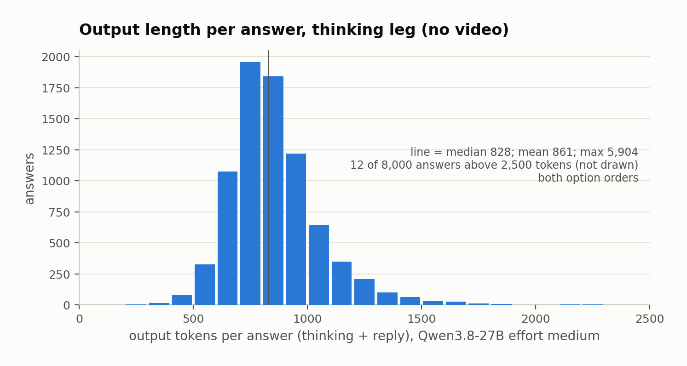

**Figure 12** (`fig_cvbench_12_order_consistency.png`): seeds right in O1 vs O2, per question
(continuous log colour scale).

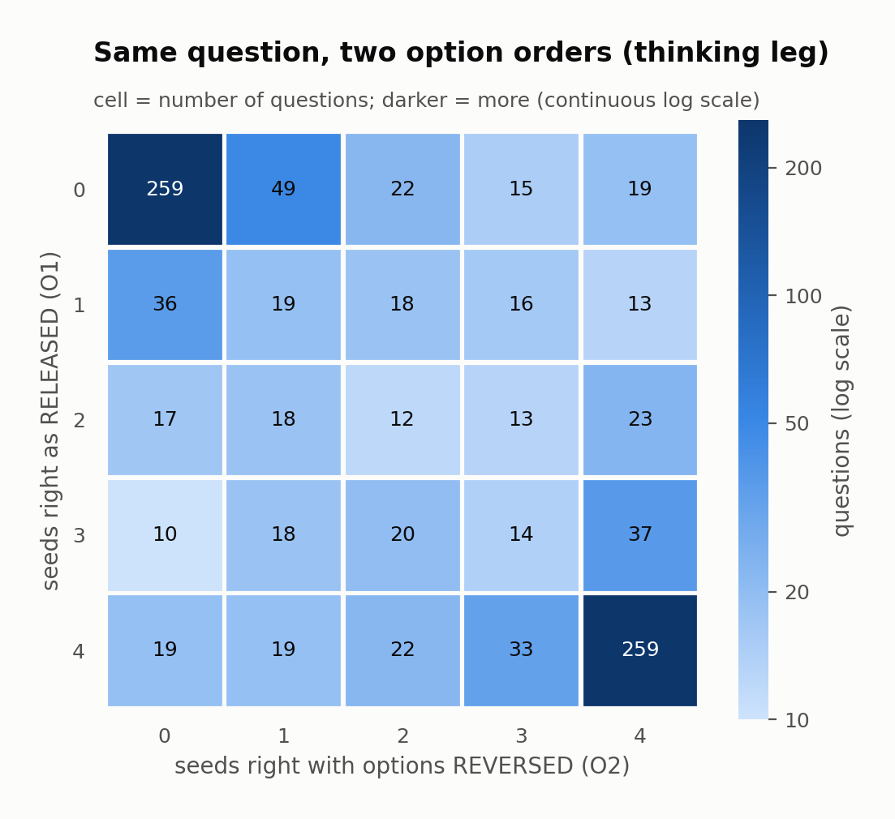

---

## 3. Results: text-only answerability

Sources:
[`cvbench_text_answerability_q38bm.json`](../multicam_results/cvbench_text_only/cvbench_text_answerability_q38bm.json)
(thinking) and
[`cvbench_text_answerability_q38nt2.json`](../multicam_results/cvbench_text_only/cvbench_text_answerability_q38nt2.json)
(no thinking). They are built by MultiCam's `analysis/cvbench_text_answerability.py` from the rows
listed in section 6.

### 3.1 Headline

All 1000 questions, 4 seeds each, no visual input. Error rows: 0. Unparsed answers: 0.

| | O1 (released order) | O2 (reversed) |
|---|---:|---:|
| **thinking, effort medium** (`_q38bm`) | **49.33 ± 0.72** | **49.70 ± 0.64** |
| **no thinking** (`_q38nt2`) | **48.10 ± 0.60** | **48.98 ± 0.44** |
| chance (mean 1/n_options) | 28.48 | 28.48 |
| best answer-key guesser: modal answer per (task × answer space: Yes/No, A–B or A–D), in-sample / leave-one-out (ties split evenly; the three questions alone in their stratum scored at chance) | 37.4 / 30.9 | 37.5 / 31.0 |
| pick the longest option (863 lettered questions; ties split; malformed `cvb-996` excluded) | 31.7 | 31.7 |
| bias null: thinking answers shuffled within (task × answer space) | 30.2 [27.9, 32.5] | 30.4 [28.1, 32.7] |
| bias null: no-thinking answers shuffled within (task × answer space) | 31.1 [29.0, 33.3] | 31.3 [29.2, 33.5] |
| InternVL3-8B **with** video (Era 1, 4 passes, for reference) | 61.83 | — |

- **± values** are population standard deviations over the 4 passes.
- **No-thinking control.** As run, every batched call of both legs was seeded with 1, which coupled
  the control's answers across questions and option orders. Its row is the rerun with per-call seeds
  (section 5, Seeds).
- **Square brackets** give the permutation 95% range (100,000 draws, seed 0). Each bias null
  shuffles whole 4-seed answer sets among questions with the same task and answer space, one order
  at a time.
- **Significance.** Both modes beat every null with p < 0.0001: no draw reached the observed value
  (the floor is 1/100,001).
- **Key-guesser floor.** Holding a question out leaves the modal answer tied for 96 questions in
  five four-option strata. In three of them (58 questions) the held-out question's gold is one of
  the tied answers, so only those depend on how ties are broken. Breaking those ties always against
  the gold or always for it, instead of splitting them, gives 28.25–34.05 (O1); one fixed letter
  order for every stratum gives 28.25–32.55. The in-sample value does not depend on ties.
- **Rounding.** Exact halves round up (1973/4000 = 49.325 → 49.33).

### 3.2 Which questions are text-answerable

A question counts as text-answerable when it is **right in ≥ 3 of 4 seeds in both option orders**.

- **Lettered questions.** The rule is strict against letter habits. Reversing the options moves
  every letter, so a letter preference cannot pass both orders. The one exception is `cvb-996`,
  whose options are packed into one string and kept as is in O2 (gold D in both). A habit that
  follows the option text can still pass both orders, as on `cvb-223`, a Yes/No question written as
  A/B options. No leg ever answers either question correctly, so no count changes.
- **The 136 Yes/No questions.** The rule is not strict. The answer is a word, so a Yes/No habit
  passes both orders.

| | thinking | no thinking |
|---|---:|---:|
| **text-answerable in both orders** | **343** | **301** |
| — of the 864 lettered questions | 296 | 241 |
| — of the 136 Yes/No questions | 47 | 60 |
| in one order only | 207 | 215 |
| in neither | 450 | 484 |
| expected under pure guessing | 15.8 | 15.8 |
| **answers shuffled across questions, orders kept together** (paired), mean [95%] | **186.6** [166, 207] | **160.5** [142, 179] |
| — lettered | 138.5 [120, 158] | 106.3 [90, 123] |
| — Yes/No | 48.2 [40, 57], p = 0.65 | 54.2 [46, 62], p = 0.10 |
| answers shuffled, each order on its own (independent null) | 88.2 [73, 104] | 83.5 [70, 98] |

**The two nulls.** Both shuffle each question's 4-seed answers among questions of the same task and
answer space.

- **Paired.** It moves a question's O1 and O2 answers together onto another question. It keeps
  answer-format habits (a letter position, the option released at a given slot, a Yes/No
  preference), each question's own cross-order consistency and the answer key's structure: an
  always-right model scores 315.5 under it. So it is a conservative baseline, and the observed excess
  over it is a lower bound on what the question text adds, not a split into habits and text. This
  is the baseline used.
- **Independent.** It shuffles the two orders separately. A habit that is the same for every
  question (always "No", always the option released at B) scores the same under both nulls
  (released-B: 258.8 of 864 under each). This null is lower only because it breaks each question's
  cross-order consistency.

The observed counts beat both nulls overall (p < 0.0001). The Yes/No passes do not beat the paired
null.

**Across the two modes**, 225 questions pass in both modes and 419 in at least one; of the 864
lettered questions, 202 and 335.
[`text_answerable_ids.json`](../multicam_results/cvbench_text_only/text_answerable_ids.json) lists
all 1000 questions with:

- their format
- k-of-4 per order and mode
- the both-orders flag per mode, plus `both_modes` and `either_mode`
- `o2_position_dependent`, true for the 48 questions whose O2 order changes an option's meaning
  (section 7)

For a deletion set on video claims, `either_mode` (419) is the conservative choice. Filter on
`format` to keep its 335 lettered questions. Its 84 Yes/No members are habit-level, so they are no
evidence of text answerability. Deleting them barely moves the Yes/No key (56% Yes left, against
58%); deleting one mode's Yes/No set would move it (74% Yes left after the thinking set, 38% after
the no-thinking set).

**Per task**, both modes, sorted by the thinking leg's share:

| task | n | chance | thinking: acc O1 / O2 | thinking: both orders | no thinking: acc O1 / O2 | no thinking: both orders |
|---|---:|---:|---|---|---|---|
| Joint-video Summarization | 52 | 25.0 | 73.1 / 78.4 | 34 (65%) | 74.0 / 77.9 | 35 (67%) |
| Multi-view Scene Understanding | 55 | 25.0 | 72.3 / 71.8 | 34 (62%) | 70.5 / 70.9 | 34 (62%) |
| Cross-video Counterfactual Reasoning | 52 | 25.5 | 72.6 / 65.9 | 30 (58%) | 67.3 / 64.4 | 26 (50%) |
| Cross-video Procedural Transfer | 51 | 25.0 | 57.8 / 61.8 | 27 (53%) | 53.9 / 57.4 | 23 (45%) |
| Multi-video Attribute Recognition | 46 | 26.1 | 50.5 / 54.3 | 17 (37%) | 50.0 / 50.0 | 14 (30%) |
| Cross-video Scene Recognition ‡ | 149 | 45.5 | 48.5 / 46.6 | 54 (36%) † | 55.4 / 56.0 | 60 (40%) |
| Video Difference Caption | 55 | 25.0 | 49.1 / 49.5 | 19 (35%) | 40.5 / 38.6 | 10 (18%) † |
| Joint-video Spatial Navigating | 42 | 26.2 | 54.8 / 48.2 | 14 (33%) | 53.6 / 50.6 | 12 (29%) |
| Cross-video Entity Matching | 74 | 27.7 | 49.3 / 46.3 | 24 (32%) | 51.0 / 46.3 | 22 (30%) |
| Multi-video Key-Action Recognition | 88 | 25.0 | 44.9 / 50.3 | 27 (31%) | 46.3 / 57.1 | 31 (35%) |
| Multi-video Temporal Reasoning | 75 | 25.7 | 38.7 / 36.0 | 17 (23%) | 30.0 / 29.3 | 8 (11%) † |
| Joint-video Counting | 60 | 25.0 | 38.8 / 38.8 | 13 (22%) † | 38.3 / 37.5 | 9 (15%) |
| Cross-video Object Recognition | 68 | 25.4 | 42.6 / 43.8 | 14 (21%) | 39.7 / 40.1 | 11 (16%) |
| Cross-video Anomaly Detection | 84 | 25.3 | 33.6 / 39.6 | 13 (15%) | 29.2 / 33.9 | 6 (7%) † |
| Cross-video Event Retrieval | 49 | 25.0 | 35.2 / 35.2 | 6 (12%) † | 31.6 / 28.1 | 0 (0%) † |

- **†** marks a count that is not above that task's paired null (one-sided p ≥ 0.05,
  uncorrected):
  - thinking: Scene Recognition p = 0.16, Counting 0.13, Event Retrieval 0.60
  - no thinking: Video Difference Caption 0.17, Temporal 0.17, Anomaly 0.14, Event Retrieval 1.0

  With a Holm correction over the 15 tasks the lists grow: thinking Anomaly Detection (p = 0.027)
  fails too, and so do no-thinking Scene Recognition and Object Recognition (p = 0.011 and
  0.020). Under the independent null only Event Retrieval failed.
- **‡** 120 of Scene Recognition's 149 questions are Yes/No, hence its 45.5% chance.

**What the thinking leg adds** (figure 7). The two legs differ in two things: thinking on at effort
medium with the harness reasoning prompt, against thinking off with a direct-answer prompt (section
5). So this is their joint effect. It is +1.0 points overall (95% interval −0.9 to +2.9, paired over
questions). Per task, three intervals exclude 0 (95%, not corrected for the 15 tasks):

- Video Difference Caption: +9.8 [+3.5, +16.1] (p = 0.0024)
- Temporal Reasoning: +7.7 [+1.4, +13.9] (p = 0.017)
- Scene Recognition: −8.1 [−16.1, −0.2] (p = 0.044)

With a Holm correction over the 15 tasks only Video Difference Caption remains (Temporal Reasoning's
adjusted p is 0.23, Scene Recognition's 0.58). Every other per-task interval includes 0.

The largest drop is Scene Recognition, −8.1. About half of it comes from the opposite
Yes/No habits: thinking answers "No" and no thinking answers "Yes" (section 3.4). On its 120 Yes/No
questions (56% Yes in the key) the change is −9.9, of which the habit shift accounts for −4.9. The
rest is that no thinking's Yes/No answers beat its own habit (57.8% vs 52.3%) while thinking's do
not (47.9% vs 47.4%). On its 29 lettered questions the change is −0.9.

**Sanity check.** Some questions have options that only name clips, such as "Video 2", "Both of
them" or "2-1-3", so no text cue can choose among them. The rule requires a clip number after
"video". There are 148 such questions, with chance 25.3%.

On them, neither mode is distinguishable from what answer-key habits reach. The best key guesser,
fitted on all 1000 questions with the conventions of section 3.1 (ties split evenly), gives 27.0
leave-one-out and 31.4 in-sample.

- thinking: 27.7 / 31.1 (O1 / O2)
- no thinking: 25.7 / 27.2

### 3.3 With-video accuracy by text-only label (vs the archived run)

The with-video run is InternVL3-8B, Era-1 best arm: sequential clips, duration-weighted, 64 frames,
4 passes, 61.8% overall. Its accuracy split by the thinking leg's both-orders label (figure 6):

| text-only label (thinking, both orders) | n | InternVL3-8B accuracy WITH video |
|---|---:|---:|
| text-answerable in both orders | 343 | 78.7 |
| in one order only | 207 | 59.3 |
| in neither | 450 | 50.1 |

The same split by the single-order (O1) label, for both modes:

| text-only label (O1) | thinking: n | with video | no thinking: n | with video |
|---|---:|---:|---:|---:|
| text-answerable (≥ 3 of 4) | 451 | 73.8 | 408 | 73.7 |
| unstable (1–2 of 4) | 185 | 60.8 | 270 | 62.2 |
| not (0 of 4) | 364 | 47.5 | 322 | 46.4 |

- **Text 0 of 4 in O1, video ≥ 3 of 4:** 154 questions with thinking (129 without).
- **Text ≥ 3 of 4 in O1, video 0 of 4:** 52 questions with thinking (54 without).

**How to read this.** The with-video score rises with the text-only label. Without the 343
text-answerable questions, InternVL3-8B is at 53.0% on the other 657.

This is an association between two different models (Qwen3.8-27B text-only, InternVL3-8B with
video). It fits a text prior in InternVL3-8B's score, but it would also appear if some questions
are simply easier for any model. Both counts above are below what independence of the two labels
would give: about 209 and 100 with thinking, 185 and 90 without. A text-only run of InternVL3-8B
would separate the two readings.

### 3.4 Answer habits

Share of predicted letters on the 864 lettered questions (figure 8). Gold is the answer key's share.
In 860 of them, which have four options, reversal swaps A↔D and B↔C.

| | A | B | C | D |
|---|---:|---:|---:|---:|
| gold, O1 | 27.0 | 30.0 | 26.7 | 16.3 |
| thinking, O1 | 17.0 | **40.2** | 29.5 | 13.3 |
| no thinking, O1 | 14.4 | **38.0** | 37.3 | 10.3 |
| gold, O2 | 16.4 | 26.9 | 29.7 | 27.0 |
| thinking, O2 | 10.2 | 26.2 | **37.4** | 26.3 |
| no thinking, O2 | 8.7 | 27.7 | **41.6** | 22.0 |

On the 136 Yes/No questions, the share answering "Yes":

| | O1 | O2 |
|---|---:|---:|
| gold | 58.1 | 58.1 |
| thinking | 29.4 | 27.8 |
| no thinking | 71.1 | 69.7 |

- **No thinking over-picks position C:** 37.3% (O1) and 41.6% (O2), against 26.7% and 29.7% gold.
- **Thinking avoids position A:** 17.0% (O1) and 10.2% (O2), against 27.0% and 16.4% gold. In O2
  the released-A options sit at D, where thinking picks them at about the gold rate (26.3% vs 27.0%).
- **Thinking over-picks the option released at B:** 40.2% against 30.0% gold. In O2 that option
  sits at C, where thinking picks 37.4% against 29.7% gold. No thinking picks B at 38.0%, 8.0
  points above gold (95% interval [+4.8, +11.2]; percentile bootstrap, 1,000,000 resamples of the
  questions, each with its 4 passes and its gold answer), so it over-picks that option too.
- **The two modes have opposite Yes/No habits.** Thinking says "No" about 71% of the time and no
  thinking says "Yes" about 70%, against 58% Yes in the key.
- **The no-thinking shares are from independent draws.** As run, each batch slot replayed one
  noise stream across questions and both orders, and the control's O1 C share ranged from 17% to
  70% by slot. The rerun `_q38nt2` seeds every call on its own (section 5, Seeds): by slot its C
  share is 32–42% (O1) and 35–50% (O2), and slot does not predict the letter (chi-square p = 0.99
  in both orders). In the same bootstrap, both habits stay above gold: C by +10.6 / +11.8 points
  (95% intervals [+7.4, +13.8] / [+8.6, +15.0]) and Yes by +13.1 / +11.6 points ([+3.3, +22.8] /
  [+1.8, +21.3]).
- **What absorbs them.** The both-orders rule removes letter-position habits on lettered questions.
  Both bias nulls keep habits that do not depend on the question (position, the option released at
  a given slot, Yes/No). A preference tied to the option texts themselves, such as picking the
  longest option, is broken like any other text cue.

---

## 4. Everything run on CVBench before (verified; smoke runs aside)

**Provenance.** Era 1 ran 2026-06-09 to 07-22. Its code and subsets are the tree of commit
[`27c96b1`](https://github.com/Wavy-Hec/MultiCam/tree/27c96b13efaa924affa76f586bc4d4c1125dd18b) on
MultiCam's `main`. The tag `cvbench-final` marks the same tree but is not on GitHub, so a clone of
the repo does not have it. Its raw rows are archived outside both repositories and are not public.
The 45-question outputs of section 4.3 are public in MultiCam's git history as
`Video-R1/src/r1-v/eval_results/eval_subset_qwen3vl{,_novideo}.json`: added in `4c1e42a`, last
present in
[`546ad45`](https://github.com/Wavy-Hec/MultiCam/tree/546ad45f4bafd9ef71e78400e2f395afa55889a0/Video-R1/src/r1-v/eval_results),
both on `main`.

The Era-1 results below were recomputed from the archived rows or from git blobs: sections 4.1, 4.3
and 4.4 in both checks, and section 4.2 in the second. The figures of the rule-based audit in 4.4
are quoted, not recomputed.

### 4.1 With video: InternVL3-8B, full 1000 questions, 4 passes, T 0.7

| arm | video tokens per question | accuracy |
|---|---:|---:|
| sequential clips, duration-weighted frame split (64 frames) | 16,384 | **61.83 ± 0.66** (2473/4000) |
| sequential clips, even split (64 frames) | 16,384 | 60.78 ± 0.78 |
| grid stitch (up to 2×2), 8 / 16 / 32 / 64 / 128 montages | 2,048 / 4,096 / 8,192 / 16,384 / 32,768 | 57.75 / 57.43 / 57.55 / 55.75 / 54.88 |
| per-stream: describe each clip (8 frames), then a text-only aggregator | 4,096–8,192 (mean 5,714) | 55.70 ± 1.01 |

All tests below are paired t-tests over the 1000 questions.

- **Stitching more montages does not help.**
  - 8, 16 and 32 montages are equal within noise (57.4–57.8).
  - Against the 8-montage arm, 64 is −2.0 (p = 0.054) and 128 is −2.9 (p = 0.0069). Against the
    16-montage arm they are −1.7 (p = 0.073) and −2.55 (p = 0.0080), so the 128-montage drop holds
    either way and the 64-montage drop is borderline.
  - The 128-montage rows carry 33,389–33,504 input tokens, past the 32,768 positions of
    InternVL3-8B's language model. Nothing in the stack truncates them. Above 32,768 positions
    transformers 4.48.3 applies the config's dynamic NTK RoPE scaling (factor 2.0), so these inputs
    ran with a slightly rescaled RoPE (base about 4% higher). Whether that costs accuracy is not
    established; the 64-montage arm, inside 32,768, is already −2.0.
- **At an equal budget, sequential beats stitching.** At 16,384 video tokens the 64-montage stitch is
  6.1 points below the duration-weighted sequential arm (p = 5.9e-8).
- **Per-stream loses to every sequential arm**, but it sees about a third of their visual tokens. The
  gap is not budget-matched, so it is not an architecture effect alone.
- **Duration-weighted vs even split** is +1.05 (p = 0.19), so the "best arm" is best by point
  estimate only.
- **Per-question stability** on the best arm (0/4 … 4/4 passes right): 221 / 104 / 102 / 127 / 446.
- **Scoring.** ± values are population SDs over the 4 passes. Abstained rows (1–14 per arm) are
  scored wrong.

### 4.2 The 130-question temporal slice (InternVL3-8B)

| run | result |
|---|---|
| greedy, 1 pass (T 0, seed 1): native, 16 frames per clip (mean 12,635 video tokens) / stitch, 16 montages of up to 5 tiles (mean 17,455), labelled "Camera i" / the same, labelled "Video i" | 51.5 / 40.0 / 56.2 |
| 4 passes (T 0.7): weighted / even, 64 frames (16,384) / stitch, 16 one-tile montages with the "Video i" framing (4,096) | 55.77 / 51.54 / 51.54 |
| 4 passes, frame selection inside clips: motion keyframes / question-relevance (CLIP) | 49.42 / 55.77 |
| 4 passes, clip selection: summary routing / summary top-1 / CLIP top-1 | 53.85 / 45.58 / 37.12 |

The "Camera i" and "Video i" runs differ in two things, switched together by one flag
(`--montage-kind camera` → `video`): the caption drawn into each montage cell ("Camera i" →
"Video i") and the text preamble before the montages (58 → 83 tokens). The preamble stops calling
the clips "time-synchronized … camera view(s)" and says they are "independent video clips
(different, unrelated scenes)", to be reasoned about "separately as well as together". Everything
else is the same: 130 questions, 16 montages per question (same video tokens on all 130), greedy,
seed 1. Together the two changes moved this one greedy pass by 16 points (52 → 73 of 130; 30
questions wrong → right, 9 right → wrong; exact McNemar p = 0.0011). These runs cannot separate the
caption from the preamble.

The greedy stitch runs carry about 38% more video tokens than the greedy native run, so that
comparison is not budget-matched. The three 4-pass arms are the section 4.1 arms on these 130
questions. They ran separately (2026-06-27), but the full-1000 run reproduced them exactly (same
prediction on all 520 question-pass pairs, same response text where it was saved), so they add
nothing beyond section 4.1.

Rows (in the Era-1 archive's `bench/results/`, not public): greedy `cvbench_temporal_native.jsonl`,
`cvbench_temporal_stitch.jsonl` (Camera i), `cvbench_temporal_stitch_videolabels.jsonl` (Video i); 4
passes `bench_cvbench_temporal_subset_internvl_{dur,even,stitch}_shard0-3.jsonl`; frame selection
`…_adaptive_shard0-7.jsonl` (`adaptive_content`, `adaptive_query`); clip selection
`…_clipsel_shard0-7.jsonl` (`summary_select_route`, `summary_select_top1`, `clip_select_top1`).

**Also run in Era 1**, offline and without answering any question: a clip-scorer gate (2026-07-08;
its output file is untracked and not in the archive, so it is not public). Of the 1,000 questions,
172 name exactly one clip (40 in the question text, 132 in the gold option). CLIP-B/32 ranks that
clip first for 83 of 172 (48.3%) and SigLIP-so400m for 82 (47.7%), against 35.2% for a random pick
(mean of 1/clips). On the 40 text-named questions alone it is 42.5–45.0% (CLIP) and 50.0% (SigLIP),
against 37.1%. Score margins were near zero and SigLIP did not beat CLIP, so no SigLIP
clip-selection run on the full 1000 followed.

### 4.3 The only earlier no-video run, and why its "+22 points" does not hold up

| | n | without video | with video |
|---|---:|---:|---:|
| Qwen3-VL-8B-Thinking, reported (Jun 2026) | 45 | 18/45 = **40.0%** | 28/45 = 62.2% |
| same outputs, today's parser (the tag, else the last "the answer is X" phrase, hedged or not) | 45 | 19/45 = 42.2% | 23/45 = 51.1% |
| same outputs, tag only (an untagged output scored wrong) | 45 | 5/45 = 11.1% | 19/45 = 42.2% |
| InternVL3-8B with video, Stage A (Jun 2026, lmms-eval, 8 frames per clip, 1 pass) | 45 | — | 25/45 = 55.6% |
| this run: Qwen3.8-27B no thinking, mean of 4 seeds, O1 / O2 | 45 | 34.4% / 38.9% | — |
| this run: Qwen3.8-27B thinking, mean of 4 seeds, O1 / O2 | 45 | 38.3% / 43.3% | — |

The reported row is the result in this repository's [`blind_sanity.md`](blind_sanity.md). The two
Era-1 Qwen3-VL output files are public in MultiCam's git history (section 4, Provenance). All 45
InternVL3-8B outputs carry an `<answer>` tag, so the parser does not change its score; its rows are
`analysis/internvl3_normalized.json` at `27c96b1`.

**Why "+22 points from video" does not hold up.**

- 34 of the 45 no-video outputs hit the 2048-token cap with no `<answer>` tag. 22 of the 45
  with-video outputs also have no tag: 21 hit the cap, and one (id 6) ended at 857 tokens with a
  bare "answer No".
- The old parser then took the first stray letter, which was "A" in all 47 truncated lettered rows
  (29 without video, 18 with).
- The slice is A-heavy, so answering a constant A/Yes also scores exactly 18/45.
- Without a tag, today's parser reads the last "answer is X"-style phrase in the trace, hedged or
  not. It reads 31 of the 34 untagged no-video outputs (14 right, 3 abstain); 16 of those 31 reads
  follow "maybe" or "perhaps", and 6 are conditionals. It reads 12 of the 22 untagged with-video
  outputs (4 right, 10 abstain); 6 of those 12 follow "maybe".
- The old parser inflated the with-video side: 62.2% falls to 51.1% under today's parser, while the
  no-video side rises from 40.0% to 42.2%.

So the video gain on these 45 questions depends on the parser: +22.2 points with the old
first-letter fallback (13 vs 3 discordant questions, exact McNemar p = 0.021), +8.9 with today's
parser (9 vs 5, p = 0.42) and +31.1 with the tag alone (16 vs 2, p = 0.0013). The slice cannot
settle it.

**What the new rows add.** A proper no-video run on the same 45 questions lands at 34–43%, close to
the old no-video level. Under today's parser it is the with-video number that moved.

On 45 questions a 4-seed-mean accuracy has a standard deviation of about 6.3 points (about 7.5 for
one pass), so only differences of roughly 18 points or more are distinguishable at 95%. The
full-1000 result in section 3 is the one to use.

### 4.4 Text-only evidence without a model

**A rule-based audit of the benchmark (an internal report of 2026-10-05, not public)**, quoted here,
not recomputed:

- The best options-only rule, chosen on four of five folds and scored on the held-out fold, scores
  36.6% against 28.5% chance.
- Six categories score more than 10 points above chance that way: Summarization 59.8, Multi-view 43.8, Temporal Reasoning 40.3,
  Key-Action 37.1, Procedural Transfer 35.3, Attribute 36.2.

**Answer-key structure** (recomputed, released order O1):

- **Four-option gold letters.** Among the 860 four-option questions the gold letters are A 232,
  B 257, C 231 and **D 140**.
  - D is 16.3% against 25% (exact binomial, two-sided p = 8.7e-10).
  - Across all four letters, chi-square(3) = 36.9, p = 4.8e-8.
  - A, B and C do not differ (p = 0.40).
- **Yes/No gold.** Yes is gold on 79/136 Yes/No questions.
- **Simple key rules**, scored on all 1000 questions:
  - "lettered → B, Yes/No → Yes": 33.8% (B is gold on 259 of the 864 lettered questions)
  - longest option on lettered questions, "Yes" on Yes/No (ties split, `cvb-996` scored a miss): 35.3%
  - modal answer per task × answer space: 37.4% in-sample, 30.9% leave-one-out (ties split,
    single-question strata at chance; the section 3.1 floor)

**Malformed rows:**

- `cvb-996` has its four options packed into one string.
- `cvb-431` has duplicated `B.` prefixes. The O2 converter re-letters it.

**The CVBench paper** (arXiv 2508.19542) reports no text-only baseline.

---

## 5. Setup

### Data

- MultiCam's `analysis/convert_cvbench.py` reads the pinned HF release `Dongyh35/CVBench@81dfee5`.
  - It writes `analysis/cvbench_full_runnable_subset.json`, shipped here as
    [`data/subsets/cvbench_full_runnable_subset.json`](../data/subsets/cvbench_full_runnable_subset.json).
    This is byte-identical to the file at `27c96b1`, so new rows join the archived legs by id.
  - `--order O2` writes `cvbench_full_runnable_subset_o2.json`, shipped here as
    [`data/subsets/cvbench_full_runnable_subset_o2.json`](../data/subsets/cvbench_full_runnable_subset_o2.json).
    It reverses the options and remaps the gold, preserving the gold text, on 999 questions.
    `cvb-996`, whose options are packed into one string, is kept as is. For 48 questions the
    reversal changes what an option means (section 7).
- No clips are on disk. This is the blind arm only.

### Model

`Qwen/Qwen3.8-27B` (HF snapshot `1d4bf0f2`, bf16) runs under HF transformers 5.2.0, on one A100-80GB
per job.

### Protocol

This is the team's 27B text-only protocol, set out in an internal protocol document and its
reference client script (neither is public):

| setting | thinking leg `_q38bm` | control `_q38nt2` |
|---|---|---|
| thinking / effort | on / medium | off |
| sampling | T 0.6, top_p 0.95, top_k 20 | same |
| passes × orders | 4 sampled passes × {O1, O2} | same |
| prompt | harness blind prompt, `REASONING=1` | direct-answer prompt |
| max new tokens | 8,192 | 8,192 |

**Seeds.** Rows stamp seeds 1–4, but these are pass labels. As run (2026-10-29/30), every batched
call of both legs was seeded with 1, so all calls of the same size drew the same random numbers,
slot by slot, whatever their questions and in both orders: each batch slot replayed one noise stream.

- With thinking this does not measurably reach the answers: in its 24-sequence calls the batch slot
  does not predict the answer letter (chi-square p > 0.9 in both orders). The thinking leg was not
  rerun.
- Without thinking, the answer is fixed at the third generated token, so the as-run control
  (`_q38nt`) drew every answer in the same batch slot from the same noise, coupling its answers
  across questions and across the two orders. Its C share (lettered answers) ranged from 17% to
  70% (O1) and 15% to 79% (O2) across the 24 batch slots, and a chi-square test of slot × answer
  letter gave p of about 1e-125 (O1) and 1e-173 (O2).
- The control was rerun on 2026-10-31 as `_q38nt2`, with `6c377c0`'s per-call seeds (Harness
  additions, below): each call of two or more sequences is seeded with a hash of its rendered
  prompts and pass labels. Every other setting is unchanged. Each order ran 167 calls, each with
  its own seed, and no seed is shared between the orders. Every call held at least 16 sequences,
  so none fell back to a pass seed. The rerun replaces the as-run control everywhere in this
  document; the as-run rows are not shipped.
- In the rerun the coupling is gone. The C share by slot is 32–42% (O1) and 35–50% (O2), and the
  slot × letter chi-square gives p = 0.99 in both orders. On the same question, O1 and O2 name the
  same answer text 60.4% of the time for the same pass and 60.2% for different passes, so the pass
  no longer matters. As run it did (56.7% and 58.5%): matched passes tended to share a letter, which
  names a different option once the order is reversed, or on Yes/No questions the same word.
- Unbatched decoding shares noise too, per pass. The harness seeds pass p of every question with
  the p-th seed, at `6c377c0` as before, and the Era-1 backend did the same. In the eight Era-1
  with-video arms on the full 1000, whose answers follow a reasoning text (median output 237–289
  tokens in the seven single-call arms; per-stream's 720 also counts its 2–4 clip descriptions),
  the letter shares of the four passes stay within 4 points of each other (at most 3.6) on the 860
  four-option questions, so no coupling shows there.

Unlike the protocol's reference client, which seeds every request, a batched row's stamped seed
cannot replay its pass.

**Deviations from the protocol: the cap, the prompt, the seeding and the serving stack.** The prompt
is the harness blind template (`REASONING=1`), not the protocol's letter prompt ("Answer with the
option's letter from the given choices directly."). The control uses the harness direct-answer
template; the protocol's thinking-off keeps the letter prompt. Calls are seeded per batch, not per
request: the thinking leg ran every batch under seed 1, the control each batch under its own
`call_seed` (Seeds, above). Decoding is batched HF transformers 5.2.0, not vLLM. The cap is 8,192, not
the protocol's 16,384. A 24-sequence batch's cache grows with its longest sample. At 16k that
exceeds the memory left beside the weights, and, at `a477d80`, an OOM would write error rows. The
cap never bound: the longest output in the thinking leg, reasoning trace plus reply, was 5,904
tokens (mean 861, median 828 over 8,000 rows). The trace alone averaged 570 tokens (median 529, max
5,593), and no trace was left unclosed.

### Harness additions

The thinking leg's rows were produced by commit `a477d80`, the code as run. At that commit all 67
tests in MultiCam `bench/tests` pass, and 15 of them (two new files) cover these additions. Commit
`6c377c0` holds the review fixes (last bullet). The control's rows (`_q38nt2`) were produced on
2026-10-31 at `f4ba98d`, which carries those fixes.

- **The `qwen38` backend.** It adds the decode preset, the template knobs `QWEN_ENABLE_THINKING` and
  `QWEN_REASONING_EFFORT`, and a `decode` stamp on every row. A resume is refused when the backend,
  dataset, media, segment identity or `decode` stamp differs. At `a477d80`, temperature, reasoning
  mode and `max_new_tokens` were not compared.
- **Answer parsing fix.**
  - At xhigh effort, Qwen3.8's thinking quoted "`<answer>` and `</answer>`", and the first-match
    parser read " and ".
  - The answer is now parsed from the reply after `</think>`, but only when the generation ended on
    an end-of-turn token. Rows stamp `parsed_from`, and `analysis/rescore_answers.py` honours it.
    Every other model parses as before.
  - No medium-effort trace quotes the tags, so the old parser would give the same 8,000 answers.
    Re-parsing them changes 0.
- **Batching.**
  - Without fla kernels, HF decode for this model is launch-bound: about 10 steps/s for one sequence
    and about 8 at 24 sequences. So `--batch-passes` and `--batch-questions 6` sample 6 questions ×
    4 passes (24 sequences) per call.
  - First-token checks on GPU: left-padded first-token distributions match the solo ones
    (KL ≤ 0.013).
  - Greedy checks: decodes diverged from the solo run on 3 of 6 prompts, at tokens 0, 37 and 87.
    The token-0 case is a near-tie (0.4994 vs 0.4994 solo). The other two were not examined.
  - A batched row therefore does not match a solo decode of its question bit for bit.
  - vLLM was not tried. Its releases from 0.20 on pin torch 2.11 or newer with CUDA 13 builds, which
    need driver 580 or newer; the cluster's GPU nodes probably run driver 550 (its login node has
    550.54.14, and no job log records the compute nodes' driver). Releases 0.17 to 0.19 pin torch
    2.10 (CUDA 12.8), like the harness's `cvbench` env, and support the Qwen3.5 architecture that
    Qwen3.8 uses. Their wheels need glibc 2.31 where the nodes have 2.28, so they might work from a
    container or a source build but were not tested.
- **Cost.**
  - About 20 A100-hours of allocation for all four legs: 19.6 thinking and 0.7 no thinking (the
    rerun; the as-run control took 0.3). This includes model loads and the in-flight batches lost
    to cancellations.
  - The rows' own GPU time is 18.9 + 0.3 h.
  - Wall clock was 22:35 to 01:15 as run, and 16:16 to 16:37 on 2026-10-31 for the control's rerun.
  - Unbatched, the thinking legs would have needed about 190 GPU-hours (8,000 answers × 861 tokens
    at about 0.10 s per step for one sequence).
- **Review fixes (commit `6c377c0`).**
  - **Seeding.** Each batched call is seeded with `call_seed`, a 31-bit SHA-256 of pass 1's seed,
    the rendered prompts in order and the pass labels. Every row stamps `call_seed` and
    `batch_slot`, and a batched leg adds `rng: call_hash_v1` to its `decode` stamp, so it can never
    resume an as-run file. Identical calls reproduce; a different batch composition, or a solo
    decode, gives different draws. The control's rerun `_q38nt2` ran with it; the thinking leg did
    not.
  - **Resume guard.** It also compares temperature (already stamped on every row), and stamps and
    compares reasoning mode and `max_new_tokens`. Rows without a stamp are not compared on that
    key, and `--allow-mixed` waives the guard.
  - **Also:** an out-of-memory split-retry in the batched blind arm; the Qwen3.8 preset is matched on
    the last path component of the model id; equivalent knob spellings stamp identically;
    `bench/metrics.py` divides a batched call's latency by `batch_n`; and the analysis script has
    guards and a provenance block (its JSON records the seed, the number of draws, the numpy version
    and the input files' hashes). At `6c377c0` all 143 tests in `bench/tests` pass.

### Analysis

`analysis/cvbench_text_answerability.py` reports, per order and for the both-orders label:

- per-question labels
- chance, key floors and the longest-option rule
- the bias nulls: per order, and for both orders both independent and paired, overall, per task
  and by format
- the clip-reference-only slice
- trace hygiene
- the sighted cross-tab against the O1 label (the both-orders split in section 3.3 and figure 6
  comes from the figure script)

The nulls draw 100,000 permutations from numpy's PCG64 generator (seed 0, numpy 1.26.4, in blocks of
10,000). Another numpy version may draw differently, within Monte Carlo error. Each JSON's
`provenance` block records these settings and the sha256 of every input file.

---

## 6. Reproduce

The code is on MultiCam's `main`: commit
[`a477d80`](https://github.com/Wavy-Hec/MultiCam/commit/a477d80047a1af2a2d3bc12396cfed563313c5a7) is
the code that produced the thinking leg's rows, and commit
[`6c377c0`](https://github.com/Wavy-Hec/MultiCam/commit/6c377c0189c4165b6963a9bbfcb5c7ec3b44d3fc)
adds the review fixes of section 5, per-call seeds among them. The shipped control, `_q38nt2`, ran
at `f4ba98d`, which carries those fixes. The launcher scripts that submitted the legs stay outside
git; the environment settings they passed to `bench/run_bench.sbatch` are in the commands below.

```bash
# in a Wavy-Hec/MultiCam checkout (the shipped analysis JSONs and figures used 6c377c0's scripts);
# replace every <...> placeholder below before running (as written they are not valid shell)
# data (no GPU)
python3 analysis/convert_cvbench.py && python3 analysis/convert_cvbench.py --order O2
# bench/run_bench.sbatch is set up for the cluster the legs ran on: edit its partition (-p), its
# REPO checkout path and its conda setup for another. It sets HF_HUB_OFFLINE=1, so Qwen/Qwen3.8-27B
# must already be in the HF cache, and it logs to analysis/logs/, which a fresh clone lacks.
mkdir -p analysis/logs
# legs, one GPU per array task (plus the cluster's own sbatch options): the no-thinking control
# first (1 shard per order), then thinking (4 shards per order). CHUNK must equal the array width.
# A re-run needs new TAGs (below).
COMMON="ENV=cvbench BACKENDS=qwen38 METHODS=blind PASSES=4 SEEDS=1,2,3,4 MAX_NEW_TOKENS=8192"
COMMON="$COMMON STRICT_ANSWER_PROMPT=0 CVBENCH_ALLOW_AVI=0 BATCH_PASSES=1 BATCH_QUESTIONS=6"
O1=analysis/cvbench_full_runnable_subset.json
O2=analysis/cvbench_full_runnable_subset_o2.json
for S in $O1 $O2; do
  env $COMMON TEMPERATURE=0.6 REASONING=0 QWEN_ENABLE_THINKING=0 QWEN_REASONING_EFFORT= \
    SUBSET=$S CHUNK=1 TAG=_<nt-tag> sbatch --array=0 bench/run_bench.sbatch
done
for S in $O1 $O2; do
  env $COMMON TEMPERATURE=0.6 REASONING=1 QWEN_ENABLE_THINKING= QWEN_REASONING_EFFORT=medium \
    SUBSET=$S CHUNK=4 TAG=_<bm-tag> sbatch --array=0-3 bench/run_bench.sbatch
done
# analysis, once per leg (the figures need both JSONs), in an env with numpy, torch and tqdm, plus
# matplotlib for the figures (MultiCam's cvbench env has all four; about 40 s per leg on a CPU at
# the default 100,000 draws).
R=bench/results               # the legs' raw shards
A=<era1-rows-dir>             # the Era-1 with-video rows (not public; below)
S45=<era1-45-subset.json>     # the 45-question Era-1 slice (below)
OUT=<out-dir>                 # a scratch directory for the outputs
for t in <bm-tag> <nt-tag>; do      # q38bm q38nt2 = the shipped legs
  python3 analysis/cvbench_text_answerability.py \
    --blind    "$R/bench_cvbench_full_runnable_subset_cvbench_${t}_shard*.jsonl" \
    --blind-o2 "$R/bench_cvbench_full_runnable_subset_o2_cvbench_${t}_shard*.jsonl" \
    --sighted fulldur="$A/bench_cvbench_full_runnable_subset_internvl_fulldur_shard*.jsonl" \
    --sighted perstream="$A/bench_cvbench_full_runnable_subset_internvl_fullperstream_shard*.jsonl" \
    --slice era1_45="$S45" \
    --json "$OUT/cvbench_text_answerability_${t}.json"
done
# figures
python3 analysis/make_cvbench_text_figs.py --bm "$OUT/cvbench_text_answerability_<bm-tag>.json" \
  --nt "$OUT/cvbench_text_answerability_<nt-tag>.json" --archive "$A" --out "$OUT/figs"
```

- **Inputs not in this repository.**
  - **The Era-1 rows (`A`).** The InternVL3-8B with-video rows of Era 1: the `bench/results/`
    directory of an archive kept outside both repositories. They are not public. The analysis reads
    two of their arms (`--sighted`), and the figure script reads them through `--archive`.
  - **The raw shards (`R`).** The legs write them to MultiCam's `bench/results/`; result rows are
    not in git. This repository ships the same rows merged (Rows, below).
  - **The 45-question slice (`S45`).** It is not shipped here. It is byte-identical to
    `analysis/subset.json` at MultiCam `27c96b1`:
    `git show 27c96b1:analysis/subset.json > <dir>/cvbench_era1_45_subset.json`.
- **A re-run needs new TAGs.** `run_bench` resumes into an existing TAG's files, and at `6c377c0` a
  batched leg cannot resume an as-run file. The same `<bm-tag>` and `<nt-tag>` go into
  the legs, the analysis loop and the figure command; `q38bm` and `q38nt2` re-analyse the shipped
  rows (`_q38nt2` is the control's rerun under a new TAG). At `6c377c0` the figure script itself
  needs no change: it reads every Qwen number from the two analysis JSONs, figure 11's token counts
  from the row files the `--bm` JSON lists (checked by sha256), the Era-1 rows from `--archive` and
  the option counts from `--subset`.
- **Order.** A queued job reads `bench/` when it starts, so nothing under `bench/` should change
  while a task is pending. The run submitted the 2-task control first, then the 8 thinking tasks;
  the control's 2-task rerun was submitted on its own on 2026-10-31, after the thinking leg ended.
- **Temperature on resume.** At `a477d80` a missing TEMPERATURE is not caught on resume: it would
  append T 0.7 rows to the T 0.6 file. `6c377c0` compares it on resume (rows already stamp it) and
  refuses the mismatch.

**Rows.** The analysis read the raw shards
`bench/results/bench_cvbench_full_runnable_subset{,_o2}_cvbench_{q38bm,q38nt2}_shard*.jsonl` in
MultiCam's tree (result rows are not in git). The rows in this repository are those shards merged,
one file per leg and order, with the export's `leg` and `source_commit` fields added.
`source_commit` is the MultiCam commit the export was made from: `f4ba98d` for the thinking leg and
`ee7c2b0` for the control, each the commit that registers its leg for the export. The thinking leg
ran at `a477d80`; the control's rerun ran at `f4ba98d` on 2026-10-31.
[`multicam_results/README.md`](../multicam_results/README.md),
[`registry.json`](../multicam_results/registry.json) and
[`summary.csv`](../multicam_results/summary.csv) list them:

| leg | O1 (released order) | O2 (reversed) |
|---|---|---|
| thinking, effort medium (`_q38bm`) | [`cvbench_full_runnable_subset_cvbench_q38bm.jsonl.gz`](../multicam_results/legs/cvbench_full_runnable_subset_cvbench_q38bm.jsonl.gz) | [`cvbench_full_runnable_subset_o2_cvbench_q38bm.jsonl.gz`](../multicam_results/legs/cvbench_full_runnable_subset_o2_cvbench_q38bm.jsonl.gz) |
| no thinking (`_q38nt2`) | [`cvbench_full_runnable_subset_cvbench_q38nt2.jsonl.gz`](../multicam_results/legs/cvbench_full_runnable_subset_cvbench_q38nt2.jsonl.gz) | [`cvbench_full_runnable_subset_o2_cvbench_q38nt2.jsonl.gz`](../multicam_results/legs/cvbench_full_runnable_subset_o2_cvbench_q38nt2.jsonl.gz) |

- The analysis JSONs' `provenance` lists the raw shard paths, in MultiCam's tree, with their sha256.
  The figure script reads figure 11's token counts from the row files the `--bm` JSON lists and
  checks them against those hashes, so it needs the raw shards, not the merged files.
- Shard 1 of the thinking leg was split into the CHUNK=24 files `shard{1,5,9,13,17,21}`.
- Every leg and order holds exactly 4000 unique rows.

**Timeline** (all times CDT, 2026-10-29/30, unless dated):

| what | when |
|---|---|
| no-thinking control as run (`_q38nt`), O1 / O2 | 22:35–22:44 |
| thinking, O1 / O2, 4 shards each | 22:35–00:42 |
| the switch (CPU): stopped the two slow shard-1 tasks and split their remaining questions | 00:42 |
| the split pieces of shard 1, O1 / O2 | 00:43–01:12 |
| O1 piece 9, resubmitted unpinned; landed on fast cores | 01:00–01:12 |
| O2 piece 13, first resubmission; cancelled after 49 s (its cores were not logged) | 01:00–01:01 |
| O2 piece 13, pinned off cores 42–49 | 01:01–01:15 |
| finalize (CPU): first analysis JSONs and figures (later overwritten) | done 01:18 |
| by hand, after the first check: both scripts fixed and rerun (5,000 draws) | 01:59–02:01 |
| by hand, after the second check: both scripts rerun at `6c377c0` with 100,000 draws; these are the shipped thinking-leg analysis JSON and figures 3, 4, 6, 11 and 12 | 2026-10-30 |
| no-thinking control rerun with per-call seeds (`_q38nt2`), O1 / O2 | 2026-10-31, 16:16–16:37 |
| the control's analysis JSON, figures 1, 2, 5, 7, 8, 9 and 10 and the figure data redone from the rerun (same scripts, 100,000 draws); the per-question list rebuilt from the two analysis JSONs | 2026-10-31 |
| preflights and GPU validation | before 22:35 |

**Ops note.**

- **The slow cores.** Tasks whose allocated cores all sat in 42–48 on two of the cluster's GPU nodes
  decoded about 4× slower (0.53 vs 0.12 s per step; per run 0.52–0.54 vs 0.12–0.13), whatever the
  GPU. The two logged slow allocations held cores 42, 44–48 and 42–47, one on each of those nodes;
  every other logged allocation was fast, including one that held core 49. The first two slow
  shards' cores were not logged, so their cause is inferred.
- **The workaround.** A wrapper outside git pinned a task off cores 42–49, one core wider than the
  logged range.

---

## 7. Caveats

- **The cap.** 8,192 tokens. It never bound in the final legs (section 5). In the xhigh preflight
  (T 1.0), 7 of the 61 samples ran to it.
- **Early stops.**
  - In the xhigh preflight, 3 of 61 thinking samples (T 1.0) ended early: the model emitted an
    end-of-turn token right where it quotes the prompt's "`<think>` and `</think>`", after 82
    (`cvb-298`), 124 (`cvb-920`) and 1,213 tokens (`cvb-99`). The first two were abstentions; the
    third was scored C from an "answer C" in its unfinished reasoning. Four of the 61 samples are
    exact repeats of others, so 57 are distinct draws.
  - The final medium-effort legs (T 0.6) had 0 abstentions and 0 unclosed traces in 8,000 rows.
  - Effort and temperature changed together, so the cause of the difference is not isolated.
- **Batched seeding.** As run, every batched call of both legs was seeded with 1, so each batch slot
  replayed one noise stream across all calls of the same size, whatever their questions and in both
  option orders (section 5, Seeds). The thinking leg shows no detectable coupling in its answers and
  was not rerun. In the as-run control (`_q38nt`) the coupling reached the answers: the share of C
  answers by batch slot ranged 17–70% (O1) and 15–79% (O2). The control was rerun on 2026-10-31 as
  `_q38nt2` with `6c377c0`'s per-call seeds, all other settings unchanged (about 0.7 A100-hours):
  167 calls per order, each with its own seed. Its C share by slot is 32–42% (O1) and 35–50% (O2),
  and a slot × letter chi-square gives p = 0.99 in both orders. The rerun moved the control's
  accuracy from 48.55 / 49.20 to 48.10 / 48.98 and its both-orders count from 316 to 301. Apart
  from the as-run figures quoted as history here and in sections 3.4, 5 and 6, every control number in
  this document is from the rerun; the as-run rows stay in MultiCam, not here.
- **O2 changes the meaning of 48 options.** In 47 lettered questions an "All of the above", "None of
  the above" or "None of above" option moves from D in O1 to A in O2, where "the above" points at
  nothing; it is the gold in 17 of them. In `cvb-89` the gold "Both A and C." lands at A and so
  refers to itself. Among these 48, 13 pass both orders with thinking and 7 without. Their accuracy,
  O1 / O2, is 45.8 / 43.8 with thinking and 40.1 / 38.0 without. Excluding them moves headline
  accuracy by at most about 0.6 points.
  [`text_answerable_ids.json`](../multicam_results/cvbench_text_only/text_answerable_ids.json) flags
  them (`o2_position_dependent`).
- **Model mismatch.** The with-video comparison is a different model (InternVL3-8B) with a different
  sampling temperature. It shows where the text priors sit, not a matched video gain at 27B.
- **No 27B with-video run.** That needs `CVBench.zip` (40.4 GB, 37.6 GiB) re-fetched.
- **Granularity.** k-of-4 labels are coarse at the question level. The both-orders rule and the
  bias null make the counts robust, but not any single question's label.
- **Reproducibility.** Each row's sample depends on its whole call. As run, a pass repeats only when
  its entire call is rerun unchanged: same questions, same order, and seed 1 (thinking leg) or the
  same `call_seed` (control). In the preflight, identical calls repeated exactly in separate jobs.
  A stamped seed cannot replay one pass alone, and a question decoded in a different group or alone
  gets different samples. A rerun from section 6 at `a477d80` would regroup the 178 (O1) and 190
  (O2) thinking-leg questions that ran after the shard-1 split, and `6c377c0` seeds every call
  differently from the run. Either way only the thinking leg's aggregates are expected to hold. The
  control ran with one shard per order and `6c377c0`'s seeds, so a rerun of it at `f4ba98d` groups
  and seeds its calls as the run did.

---

## 8. Suggested next steps

- [ ] Use the **text-answerable list**
      ([`text_answerable_ids.json`](../multicam_results/cvbench_text_only/text_answerable_ids.json),
      filtered to lettered questions) as a deletion set for any CVBench video claim.
- [ ] Run InternVL3-8B text-only on the same questions. That separates a text prior in its
      with-video score from question easiness (section 3.3).
- [ ] If CVBench stays in scope, run one with-video 27B leg on the non-text-answerable questions.
      This needs the clips.
- [x] Rerun the no-thinking control with `6c377c0`'s per-call seeds (about 0.7 A100-hours). Done
      on 2026-10-31 as `_q38nt2`; it replaces the as-run control everywhere here (section 7).
- [ ] Port the harness changes of section 5 to this repository's harness (`inprocess/`), so that
      it can run this protocol itself.
